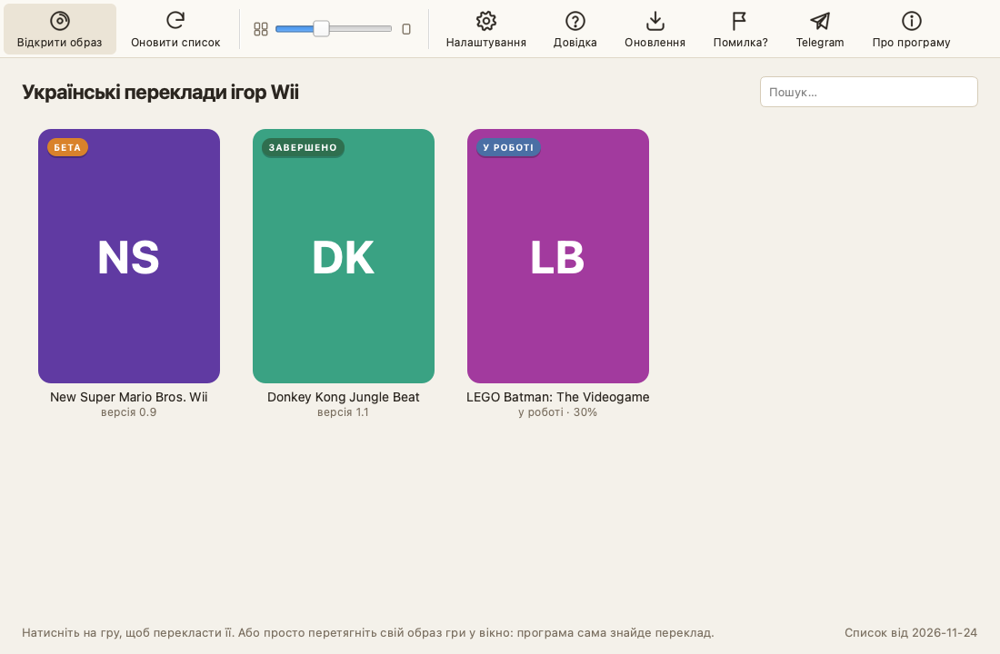

# Press Start UA Launcher

Українські переклади ігор Wii в одній програмі. Вона показує всі перекладені ігри та
їхні останні версії і застосовує переклад до **вашого власного** образу гри.



## Ігри

| Гра | Диски | Версія перекладу | Стан |
|---|---|---|---|
| New Super Mario Bros. Wii | SMNP01 (Європа, Rev 2) | 0.9 | бета |
| Donkey Kong Jungle Beat | R49E01 (США), R49P01 (Європа) | 1.1 | завершено |
| LEGO Batman: The Videogame | — | — | у роботі |

Актуальний список завжди в [catalog/catalog.json](catalog/catalog.json): програма читає його звідси
під час запуску.

## Як перекласти гру

1. Запустіть програму і натисніть на обкладинку гри (або «Відкрити образ»).
2. Виберіть чистий образ своєї гри: ISO, WBFS, CISO, WDF, WIA або GCZ. Програма сама впізнає диск.
3. Виберіть формат і натисніть «Перекласти»:
   - **ISO** — для емулятора Dolphin;
   - **WBFS** — для Wii з USB-завантажувачем;
   - **Riivolution** — для Wii з оригінальним диском (папки для SD-картки).

Ваш образ не змінюється: результат зберігається в новий файл. RVZ поки не підтримується:
перетворіть його на ISO в Dolphin («Convert File…»).

## Що тут є і чого немає

Репозиторій **не містить файлів ігор**. Патч `.uapatch` зберігає лише відмінності між
оригінальними і перекладеними файлами; програма перевіряє кожен файл вашого образу і
кожен завантажений патч за контрольною сумою. Для перекладу потрібна ваша власна копія гри.

Проєкт не пов'язаний з Nintendo. Назви ігор і Wii — торгові марки їхніх власників.

## Запуск із вихідного коду

Потрібен Python 3.9 або новіший.

```bash
python3 -m venv .venv
.venv/bin/pip install -r requirements.txt
.venv/bin/python app.py
```

Без вікна (для перевірки):

```bash
python3 cli.py list
python3 cli.py patch "Моя гра.iso" -f wbfs
```

Готові збірки для macOS і Windows з'являться в розділі Releases.

## Як влаштовано

| Шлях | Що це |
|---|---|
| `app.py`, `texts.py` | вікно програми (PySide6) і тексти довідки |
| `cli.py` | те саме з командного рядка |
| `uapatch/` | рушій: формат патча, застосування через wit, список перекладів |
| `catalog/` | список перекладів, патчі, обкладинки |
| `tools/import_patch.py` | додати новий переклад або версію до списку |
| `tools/make_cover.py` | зробити обкладинку з українського логотипа гри (якщо немає скану коробки) |
| `wit/` | Wiimms ISO Tools для macOS, Windows, Linux |
| `fonts/` | шрифт Nunito для обкладинок |

## Зв'язок

- Новини перекладів і питання: [Telegram](https://t.me/press_start_ua)
- Помилки: [Issues](https://github.com/press-start-ua/launcher/issues) або Telegram (кнопка «Помилка?» у програмі)

## Ліцензії

- Код програми: GNU GPL v3 ([LICENSE](LICENSE)).
- **Wiimms ISO Tools (wit)** © Dirk Clemens, GNU GPL v2 ([wit/gpl-2.0.txt](wit/gpl-2.0.txt)),
  вихідний код: <https://wit.wiimm.de>, див. [wit/README.txt](wit/README.txt).
- **Qt for Python (PySide6)**: GNU LGPL v3.
- **Nunito**: SIL Open Font License 1.1 ([fonts/Nunito-OFL.txt](fonts/Nunito-OFL.txt)).
- Усі шрифти в самих перекладах вільні (SIL Open Font License), перелічені в README кожного перекладу.
